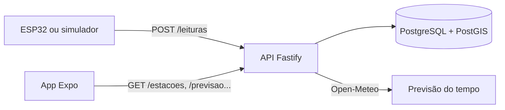

# Aplicativo

> Resumo da stack, das telas e do estado atual do software. O código está no repositório [**aquascan-app**](https://github.com/Mateus-Fonseca847/aquascan-app). As justificativas de cada escolha estão na [decisão 001](../decisoes/001-stack-do-aplicativo.md). Detalhes de API, banco e instalação ficam na documentação do próprio repositório do app, para não duplicar informação.
justificativas de cada escolha estão na [decisão 001](../decisoes/001-stack-do-aplicativo.md). Detalhes de API, banco e instalação ficam na documentação do próprio repositório do app, para não duplicar informação.

**Situação em 27/10/2026:** v0.1.0 em desenvolvimento, validada em 13/10/2026 com um simulador de estações. O caminho completo funciona: leitura → API → estado do rio → alerta → app. Faltam cadastro, pesquisa por rua e notificações push.

## Como funciona



A estação envia a distância medida até a água. A API converte em nível, calcula o percentual e o estado (**estável, atenção, crítico**) e registra um alerta quando o estado piora. As regras de cálculo ficam em `packages/shared` e são usadas igualmente pela API e pelo app. As fórmulas estão em [arquitetura.md](../02-solucao/arquitetura.md).


## Stack

| Camada | Tecnologia |
|---|---|
| Linguagem | TypeScript 6 |
| Aplicativo | React Native 0.86 com Expo SDK 57 e Expo Router |
| Mapa | react-native-maps |
| Dados no app | TanStack Query |
| Notificações | Expo Notifications (a implementar) |
| API | Node.js 22+ com Fastify 5 e Zod 4 |
| Banco de dados | PostgreSQL 17 com PostGIS, acessado pelo Prisma 7 |
| Ambiente local | Docker Compose |
| Organização | Monorepo com pnpm workspaces |
| Testes e CI | Vitest e GitHub Actions |
| Serviços externos | Open-Meteo (tempo), ViaCEP (endereço), OpenStreetMap (ruas) |

## Telas

| Tela | Conteúdo |
|---|---|
| Mapa (início) | Estações coloridas pelo estado |
| Detalhe da estação | Nível em %, estado e estimativa |
| Previsão do tempo | Próximos dias |
| Pontos de apoio | Lista e mapa, com distância |
| Cadastro e login | Nome, e-mail, número de contato e CEP |
| Perfil | Dados do usuário e preferências de alerta |


## Estrutura do repositório

```
aquascan-app/
├── apps/
│   ├── api/              ← API (Fastify + Prisma)
│   └── mobile/           ← App (Expo)
├── packages/
│   └── shared/           ← regras de nível e estado, validações e tipos
├── tools/
│   └── simulador/        ← imita uma estação enviando leituras
├── docs/                 ← requisitos, arquitetura, banco, API, decisões
├── docker-compose.yml    ← PostgreSQL + PostGIS para desenvolvimento
└── .github/workflows/    ← CI: formatação, tipos e testes
```

O simulador permite desenvolver e demonstrar o app antes de existir uma estação no rio. Ele tem um cenário de cheia que leva o estado de estável a atenção e depois a crítico.

## Validação

Registro completo em `docs/validacao.md`, no repositório do app.

| Verificação (13/10/2026) | Resultado |
|---|---|
| Tipos (4 pacotes) | Aprovado |
| Testes de `shared` | 31 aprovados |
| Testes da API sem banco | 4 aprovados |
| Seed | 2 rios, 2 estações, 96 leituras e 3 pontos de apoio |
| Pontos de apoio por proximidade | Ordenados corretamente (678 m e 1.278 m) |
| Simulador, cenário de cheia | Estado passou de estável a atenção e a crítico; 2 alertas registrados |

## Do piloto para várias cidades (proposta, a validar)

Hoje o banco e o app foram pensados para Petrópolis: ruas importadas do OpenStreetMap, pontos de apoio e estações da cidade. Para atender outras cidades, o caminho provável é:

1. Criar a entidade **cidade** e ligar a ela estações, ruas e pontos de apoio.
2. Automatizar a importação de ruas do OpenStreetMap por cidade.
3. Criar um painel e um acesso por órgão, para que cada Defesa Civil veja só a sua cidade (não existe hoje).